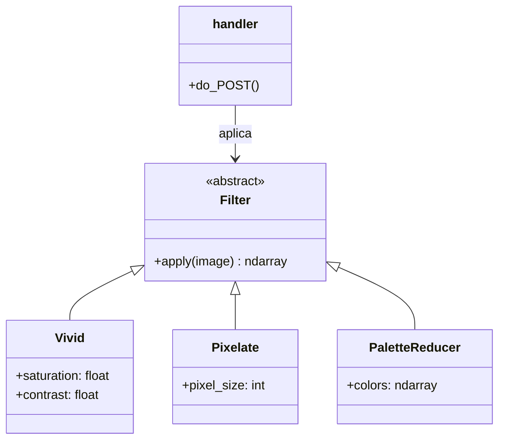

# Pixel Art 8-bit

Convierte cualquier foto en **pixel art** estilo videojuego retro: cuadraditos grandes y pocos colores.

🎮 **Probalo acá:** https://pixel-art-ten-rho.vercel.app/

Proyecto final de Procesamiento de Imágenes · **Rocío Vázquez**

## Qué hace

1. Subís una foto (desde la compu, o desde el celular con la cámara).
2. Elegís el **tamaño de los cuadraditos** y una **paleta de colores**: consola (16 colores), retro, gameboy (4 verdes) o blanco y negro.
3. La página muestra el **antes y el después**, y podés **descargar** el resultado.

Extras: letras pixeladas, música chiptune original generada por el navegador (botón 🔊) y un cursor de fantasmita pixelado.

## Cómo funciona

Cada foto pasa por tres filtros, en este orden:

| Filtro | Qué hace | Cómo |
| --- | --- | --- |
| `Vivid` | Pone los colores más vivos y con más contraste | `ImageEnhance.Color` y `ImageEnhance.Contrast` de Pillow |
| `Pixelate` | Convierte la foto en cuadraditos | Achica la foto promediando (`Image.BOX`) y la vuelve a agrandar sin suavizar (`Image.NEAREST`) |
| `PaletteReducer` | Deja solo los colores de la paleta | Cambia cada píxel por el color de la paleta más cercano (distancia entre colores RGB y `argmin`) |

## Diseño

- **Clase abstracta `Filter`** con un método `apply(image) -> image`. Todos los filtros heredan de ella.
- **Polimorfismo:** la API aplica los filtros en un `for` sin preguntar cuál es cada uno, así que agregar un filtro nuevo es crear la clase y sumarla a la lista, sin `if/elif`.
- **Paletas en un diccionario** (`PALETTES`): para agregar una paleta alcanza con una entrada nueva.
- **Sin números mágicos:** los ajustes (tamaño del pixel, saturación, contraste) son parámetros con valor por defecto.
- **Validación:** un tamaño de pixel menor a 1 o una paleta que no existe lanzan `ValueError`, y la API responde con un mensaje de error claro.



### Decisiones

- **¿Por qué `Vivid` antes de pixelar?** Las fotos de celular tienen colores apagados. Probando con una foto de un vaso azul, el azul terminaba convertido en gris porque era el color más cercano de la paleta. Al realzar los colores antes, la paleta los reconoce bien.
- **¿Por qué la paleta "consola"?** La paleta "retro" no tiene tonos de piel, y las caras quedaban manchadas. "Consola" tiene rosados, durazno y marrones, y las caras se ven mucho mejor.
- **¿Por qué Pillow + NumPy y no OpenCV?** OpenCV es muy pesado para publicarlo en Vercel, y para este proyecto no hace falta.
- **La foto se achica en el navegador** antes de enviarla (lado mayor de 1200 px), porque Vercel no acepta archivos muy pesados y las fotos de celular pesan mucho.

## Estructura

```
pixelart/filters.py     # los filtros y las paletas (el "core")
api/pixelate.py         # API: recibe la foto por POST y devuelve el PNG
index.html              # la página web
cursor.svg              # el cursor de fantasmita
tests/test_filters.py   # tests de los filtros
requirements.txt        # librerías que instala Vercel
```

La API recibe la foto en el cuerpo del pedido y las opciones en el link:
`POST /api/pixelate?pixel_size=12&palette=consola`

## Tests

```bash
pip install numpy pillow pytest
python -m pytest -v
```

Prueban que pixelar mantenga el tamaño y arme cuadraditos de un solo color, que solo queden colores de la paleta, que `Vivid` realce los colores, que los valores inválidos den error y que ningún filtro modifique la foto original.

## Publicación

La página está publicada en **Vercel**, conectada a este repositorio: cada commit se publica solo en unos segundos.

## Limitaciones

- Con cuadraditos muy grandes se pierden los detalles chicos, como los ojos.
- Las paletas tienen pocos colores, así que algunos tonos terminan cambiados por el más parecido.